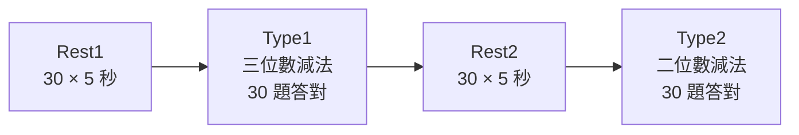
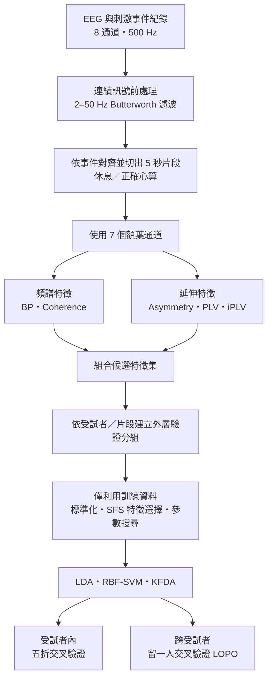
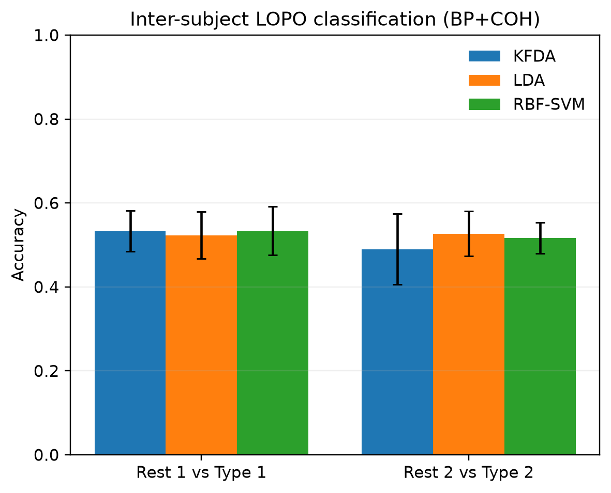
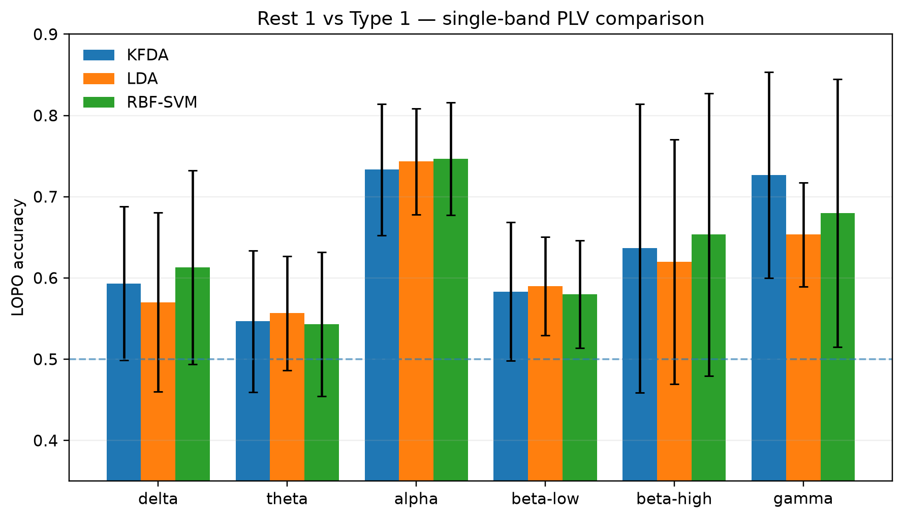
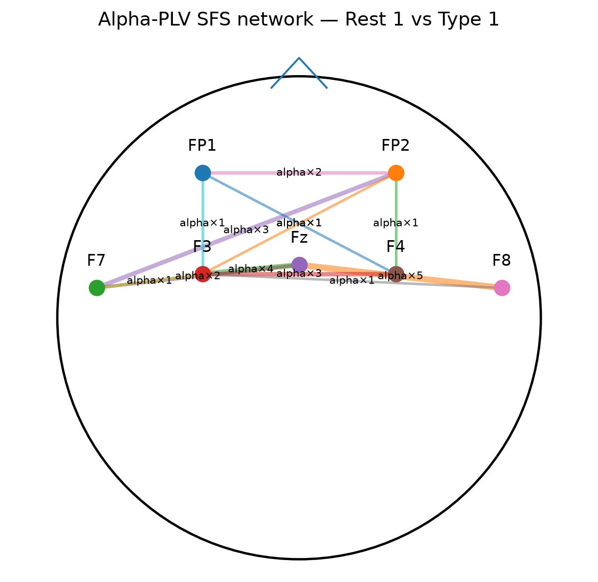
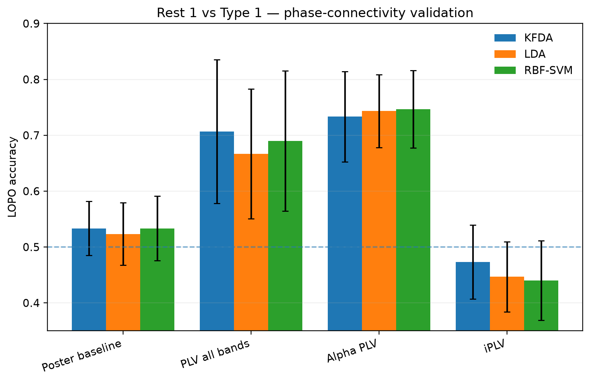
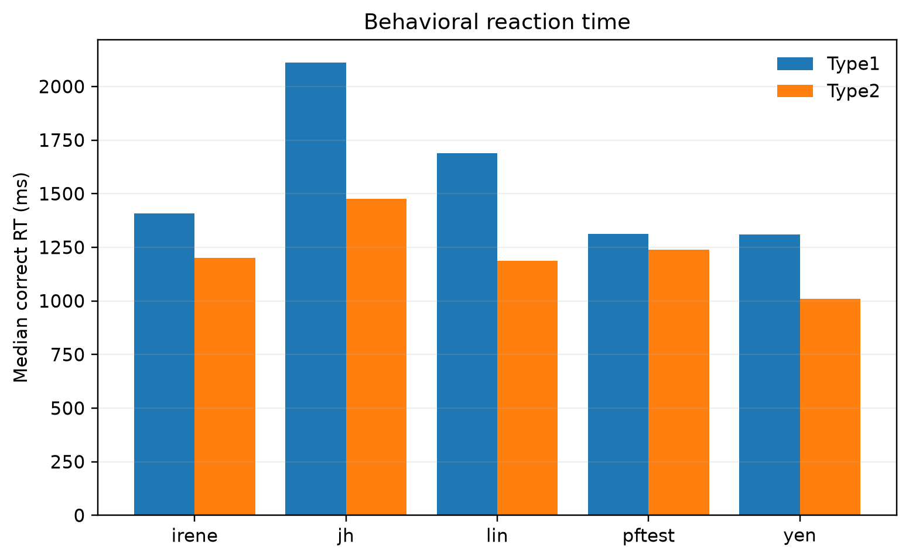
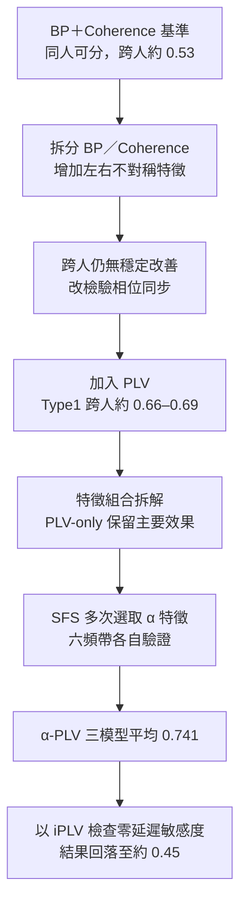

# 心算 EEG 狀態辨識：頻譜與相位連結特徵分析

**Mental Arithmetic EEG — Spectral & Phase-Connectivity Analysis**

以額葉腦電圖（EEG）辨識**休息**與**心算**狀態，並探討模型從同一受試者延伸至未見受試者時的泛化能力。研究由頻帶功率（BP）與相干性（Coherence）的既有分析方法出發，進一步比較額葉半球不對稱性、相位鎖定值（PLV）與虛部相位鎖定值（iPLV）。

| 研究規模 | 主要驗證方式 | 核心觀察 |
| :-- | :-- | :-- |
| **5 位受試者、600 個 EEG 片段** | 受試者內五折、跨受試者留一人驗證（LOPO） | **Type1 的 α 頻帶 PLV：三模型平均準確率 74.1%** |

> **研究摘要：** BP＋Coherence 可辨識同一受試者的休息與心算狀態，但跨受試者分類約接近隨機猜測。PLV 改善了 Type1 的跨人分類；六個頻帶分別比較後，以 α 頻帶的表現最突出。當改用降低零延遲同步影響的 iPLV 時，增益沒有保留，顯示目前的分類訊息對零延遲或近零延遲成分高度敏感。

## 研究背景與目標

心算同時涉及注意力、工作記憶與資訊處理，適合作為短時間、可控制的認知負荷任務。EEG 具有非侵入式與高時間解析度等優點，能觀察任務過程中的神經電活動。然而，不同受試者的基礎節律、電極接觸與訊號分布存在差異，使得**同一人內容易分類，不代表模型能直接應用於新受試者**。

本研究圍繞三個問題：

1. 以 BP 與 Coherence 建立的基準流程，能否區分休息與心算？受試者內與跨受試者表現有何差異？
2. 加入左右額葉相對功率或相位同步特徵，是否能改善跨受試者分類？增益來自哪些特徵與頻帶？
3. 若 PLV 改善分類，這項結果在降低零延遲相位同步影響後，是否仍然成立？

## 實驗設計與資料

| 項目 | 設定 |
| :-- | :-- |
| 量測設備 | HNC EAmp，8 個 EEG 記錄通道，500 Hz |
| 記錄電極 | FP1、FP2、F7、F3、Fz、F4、F8、Cz |
| 特徵分析電極 | **7 個額葉通道**：FP1、FP2、F7、F3、Fz、F4、F8 |
| 任務流程 | Rest1 → Type1 → Rest2 → Type2 |
| Type1 | 三位數減法；累積 30 題答對 |
| Type2 | 二位數減法；累積 30 題答對 |
| Rest1 / Rest2 | 各 150 秒，分別切為 30 個 5 秒片段 |
| 每次心算試次 | 心算 5 秒 → 注視十字 2 秒 → 不限時作答 → 注視十字 2 秒 |
| 正式分析區段 | 休息片段，以及**答對試次的 5 秒心算片段** |
| 分類比較 | Rest1 vs Type1；Rest2 vs Type2 |

每個心算試次的刺激時序如下；正式的「心算」類別只取計算中的五秒鐘，不包含回答按鍵階段。

五位受試者每人均得到兩組各 60 筆的二分類資料（30 休息＋30 正確心算），總計 **300 筆休息、300 筆心算，共 600 筆 5 秒 EEG 片段**。兩組任務分開建模與報告，避免直接把不同難度及不同時間位置的資料混為同一個比較。

## 從 EEG 到分類結果

### 訊號處理與頻帶

連續 EEG 經 **四階 Butterworth 2–50 Hz 零相位濾波**，再依刺激事件切成 5 秒片段；每段包含 2,500 個取樣點，頻率解析度為 0.2 Hz。

| 頻帶 | 頻率 |
| :-- | --: |
| Delta（δ） | 1–4 Hz |
| Theta（θ） | 4–8 Hz |
| Alpha（α） | 8–13 Hz |
| Beta-low（β低） | 13–20 Hz |
| Beta-high（β高） | 20–30 Hz |
| Gamma（γ） | 30–45 Hz |

註：頻帶名稱沿用研究設定；由於前處理高通下限為 2 Hz，δ 頻帶的 1–2 Hz 成分會受到衰減。

### 特徵的意義與維度

| 特徵 | 計算概念 | 候選特徵數 |
| :-- | :-- | --: |
| **頻帶功率（BP）** | 單一電極在各頻帶的頻譜能量；7 通道 × 6 頻帶 | **42** |
| **相干性（Coherence）** | 兩電極在頻域的一致程度；21 電極對 × 6 頻帶 | **126** |
| **額葉半球不對稱性（Asymmetry）** | 三組左右同源電極的對數功率差；3 對 × 6 頻帶 | **18** |
| **相位鎖定值（PLV）** | 兩電極相位差隨時間的一致性；21 對 × 6 頻帶 | **126** |
| **虛部相位鎖定值（iPLV）** | 平均相位向量的虛部幅值，降低精確零延遲成分的影響 | **126** |
| **α 頻帶 PLV** | 僅保留 8–13 Hz 的 21 組電極對 | **21** |

基準特徵集為 **42 BP ＋ 126 Coherence ＝ 168 個候選特徵**。加入不對稱性與 PLV 後，完整候選集最多為 **312 個特徵**；iPLV 為另外驗證的相位表示，並未計入這 312 個之中。

幾項核心定義：

$$
\mathrm{BP}_{b}=\sum_{f_k\in b}|X[k]|^2
$$

$$
C_{xy}(f)=\frac{|\overline{G_{xy}}(f)|^2}
{\overline{G_{xx}}(f)\,\overline{G_{yy}}(f)}
$$

$$
\mathrm{ASYM}_{b}
=\log(\mathrm{BP}_{R,b}+\varepsilon)-\log(\mathrm{BP}_{L,b}+\varepsilon)
$$

$$
R_{xy}=\frac{1}{T}\sum_{t=1}^{T}e^{j[\phi_x(t)-\phi_y(t)]},
\qquad
\mathrm{PLV}_{xy}=|R_{xy}|,
\qquad
\mathrm{iPLV}_{xy}=|\mathrm{Im}(R_{xy})|
$$

其中 \(b\) 為頻帶、\(X[k]\) 為離散傅立葉轉換、\(G_{xx}/G_{yy}/G_{xy}\) 分別為自功率與交叉功率譜估計，\(L/R\) 為左右同源電極，\(\phi_x,\phi_y\) 為窄頻解析訊號的相位。BP 沿用實驗室教材的 **DFT 平方幅值頻帶總和**；Coherence 則先將每個 5 秒片段分為五個不重疊的 1 秒區段，平均頻譜後計算平方幅度相干性。

### 特徵選擇、分類器與驗證

**順序向前特徵選擇（SFS）**由候選特徵中逐一增加最能改善訓練資料內交叉驗證表現的特徵，採 LDA 作為選擇準則。每一個外層驗證折的三個分類器共用該折選出的特徵子集。

| 模型 | 角色 |
| :-- | :-- |
| LDA | 線性判別分析，作為線性分類基準 |
| RBF-SVM | 使用高斯徑向基底核函數的非線性支持向量機 |
| KFDA | 核費雪判別分析，以核函數建立非線性判別方向 |

RBF-SVM 與 KFDA 於訓練資料內搜尋參數 \(C\) 與 \(\gamma\)；KFDA 的正則化參數採 \(\lambda=1/C\)。

- **受試者內五折驗證**：在同一位受試者的片段中輪流分配訓練與測試資料，評估個人內的狀態可分性。
- **跨受試者 LOPO**：每次保留一整位受試者作為測試，其餘四位訓練，輪流測完五人；內層特徵選擇與調參仍依受試者分組。

標準化、SFS 與模型調參均只使用外層訓練資料。圖表上的「BP＋COH」等標籤代表**送入 SFS 的候選特徵組合**，並非不經篩選便將所有特徵直接輸入分類器。

## 結果：從基準分類到 α 頻帶 PLV

### 1. 基準方法：同人可分，跨人較難

| 二分類任務 | 驗證 | KFDA | LDA | RBF-SVM |
| :-- | :-- | --: | --: | --: |
| Rest1 vs Type1 | 受試者內五折 | 0.823 | 0.803 | 0.817 |
| Rest1 vs Type1 | 跨受試者 LOPO | 0.533 | 0.523 | 0.533 |
| Rest2 vs Type2 | 受試者內五折 | 0.717 | 0.710 | 0.713 |
| Rest2 vs Type2 | 跨受試者 LOPO | 0.490 | 0.527 | 0.517 |

BP＋Coherence 在受試者內具有明顯辨識能力，跨受試者表現卻接近二分類的隨機猜測水準 **0.50**。這形成後續特徵分析的核心問題：**如何減少對個人訊號特性的依賴？**

### 2. 從頻譜拆解走向相位特徵

先比較 **BP-only、Coherence-only 與 BP＋Coherence**，跨人結果仍接近隨機猜測。接著利用 FP1–FP2、F3–F4、F7–F8 三組左右對稱電極建立相對功率特徵；**BP＋Coherence＋Asymmetry** 也未得到穩定增益。

因此改從**相位差的一致性**出發，引入 PLV。在 Rest1 vs Type1 的 LOPO 測試中：

| 分類器 | BP＋Coherence | BP＋Coherence＋PLV |
| :-- | --: | --: |
| KFDA | 0.533 | **0.667** |
| LDA | 0.523 | **0.687** |
| RBF-SVM | 0.533 | **0.660** |

三種分類器均有提升，多數留出受試者也呈現同方向改善。Rest2 vs Type2 並未出現相同幅度的改善。

### 3. PLV 增益來自哪種組合？

為區分 PLV 本身的效果與其他頻譜特徵的互補性，固定相同的驗證流程，只調整候選特徵組合。

| Rest1 vs Type1（LOPO） | KFDA | LDA | RBF-SVM |
| :-- | --: | --: | --: |
| BP＋Coherence | 0.533 | 0.523 | 0.533 |
| BP＋Coherence＋PLV | 0.667 | 0.687 | 0.660 |
| **PLV-only** | **0.707** | 0.667 | **0.690** |
| BP＋PLV | 0.687 | 0.640 | 0.650 |
| Coherence＋PLV | 0.663 | 0.683 | 0.647 |
| Asymmetry＋PLV | 0.673 | **0.703** | 0.680 |
| **BP＋Coherence＋Asymmetry＋PLV（全部候選類型）** | 0.620 | 0.647 | 0.610 |

**PLV-only 已保留主要跨受試者增益**。增加全部候選類型沒有更好的結果，說明特徵數量增加未必改善跨人泛化。此處的「全部」仍經過相同的 SFS 特徵選擇。

### 4. 為什麼進一步研究 α 頻帶？

在包含六個頻帶的 PLV 特徵選擇中，**Fz–F8、F3–F4、FP2–F7 等 α 頻帶電極對**反覆被選取。因此形成「PLV 的跨人訊息可能集中於 α 頻帶」的假說，再讓六個頻帶**各自獨立**接受相同 LOPO 驗證。

| 單一頻帶 PLV | KFDA | LDA | RBF-SVM | 三模型平均 |
| :-- | --: | --: | --: | --: |
| **Alpha（α）** | **0.733** | **0.743** | **0.747** | **0.741** |
| Gamma（γ） | 0.727 | 0.653 | 0.680 | 0.687 |
| Beta-high（β高） | 0.637 | 0.620 | 0.653 | 0.637 |
| Delta（δ） | 0.593 | 0.570 | 0.613 | 0.592 |
| Beta-low（β低） | 0.583 | 0.590 | 0.580 | 0.584 |
| Theta（θ） | 0.547 | 0.557 | 0.543 | 0.549 |

α 頻帶的三模型平均準確率為 **74.1%**，在這六組單頻帶實驗中最高；各模型結果也較接近，留出受試者之間的變異相對較低。

> 圖中的連線表示「特徵在 SFS 中被選取的次數」，不等同於已確認的腦區因果連結。

### 5. 零延遲敏感度：iPLV 的檢驗

一般 PLV 對穩定、接近零相位差的同步也可能給出高值；共同參考電極、容積傳導與共享訊號來源均可能影響這項量測。因此，以 **iPLV** 降低精確零延遲同步的影響，檢查分類增益能否保留。

| Rest1 vs Type1（LOPO） | KFDA | LDA | RBF-SVM |
| :-- | --: | --: | --: |
| BP＋Coherence | 0.533 | 0.523 | 0.533 |
| 全頻帶 PLV-only | 0.707 | 0.667 | 0.690 |
| **α 頻帶 PLV-only** | **0.733** | **0.743** | **0.747** |
| iPLV-only | 0.473 | 0.447 | 0.440 |

**iPLV 回落至約 0.44–0.47**，先前 PLV 的改善未被保留。這顯示本資料中的 PLV 分類增益高度依賴零延遲或近零延遲相位成分；其中可能同時包含真實神經同步與量測因素，目前無法分離其來源。

### 6. 行為表現提供的任務背景

Type2 的五位受試者皆達 **100% 作答正確率**，且答對試次的反應時間中位數通常較短；Type1 有部分受試者需進行 31–34 題，才能累積 30 題答對。Type2 因此呈現明顯的正確率天花板效應，其較弱的跨人 EEG 分類表現可能與任務難度有關，但現有資料不足以單獨證明因果關係。

## 研究推導脈絡

下圖將各次比較整理為**逐步形成假說並驗證的分析路徑**，並非事前列出的對稱特徵排列競賽。

## 結論與未來展望

**研究結論。** BP＋Coherence 的受試者內分類表現優於跨受試者；PLV 對 Type1 的跨人辨識有一致的探索性增益。PLV-only 保留主要效果，α 頻帶在六個單頻帶比較中表現最高。iPLV 的結果顯示分類增益對零延遲相位同步具有高度敏感性，因此 **α-PLV 可視為本資料中具有辨識力的特徵表示，但尚不能直接解讀為可靠的腦區功能連結指標**。

**未來方向。** 擴大受試者樣本並以事先固定的 α-PLV 流程進行獨立驗證；評估眼動、參考電極與更高密度 EEG 的影響；以 ciPLV、PLI、wPLI 或虛部相干性等方法補充連結特徵檢驗；改善任務順序、疲勞與學習效應的控制。

本研究的分析共使用 **5 位受試者**，且多個特徵假說與頻帶比較皆源自同一批資料。因此 **74.1% 是目前資料的探索性 LOPO 結果**，不應視為已在獨立新受試者樣本中確認的準確率。

## 相關資料與參考文獻

研究的 [完整結果摘要](docs/final_results_summary.md)、[方法定義](docs/method_definition.md)、[分類原始結果](results/final_validation/final_validation_summary.csv) 與 [最終圖表](results/final_figures/) 可供進一步查閱。

主要文獻：

1. So *et al.*, “An evaluation of mental workload with frontal EEG,” *PLoS ONE*, 2017. [DOI](https://doi.org/10.1371/journal.pone.0174949)
2. Sammer *et al.*, “Relationship between regional hemodynamic activity and simultaneously recorded EEG-theta associated with mental arithmetic-induced workload,” *Human Brain Mapping*, 2007. [DOI](https://doi.org/10.1002/hbm.20309)
3. Lachaux *et al.*, “Measuring phase synchrony in brain signals,” *Human Brain Mapping*, 1999. [DOI](https://doi.org/10.1002/(SICI)1097-0193(1999)8:4%3C194::AID-HBM4%3E3.0.CO;2-C)
4. Bastos and Schoffelen, “A tutorial review of functional connectivity analysis methods and their interpretational pitfalls,” *Frontiers in Systems Neuroscience*, 2016. [DOI](https://doi.org/10.3389/fnsys.2015.00175)
5. Bruña *et al.*, “Phase locking value revisited: Teaching new tricks to an old dog,” *Journal of Neural Engineering*, 2018. [DOI](https://doi.org/10.1088/1741-2552/aacfe4)
