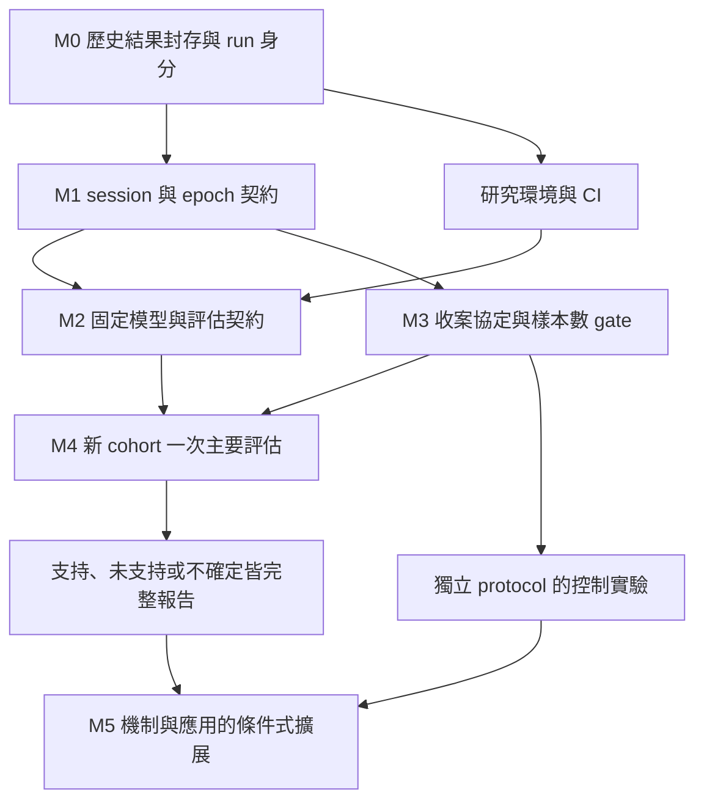

# 研究與工程路線圖：從探索結果到獨立驗證

規劃日期：2026-11-09（Asia/Taipei）  
檢查基準：[`df6b1394f0f68c4ce5a3c6659f09cc7fb918ecc1`](https://github.com/PME26Elvis/eeg-ma-spectral-connectivity/tree/df6b1394f0f68c4ce5a3c6659f09cc7fb918ecc1)  
狀態：**研究規劃與實作追蹤；正式研究結果維持封存。**

規劃 PR：[#6](https://github.com/PME26Elvis/eeg-ma-spectral-connectivity/pull/6)；實作追蹤見第 6 節的獨立 Issues。

W1（[#7](https://github.com/PME26Elvis/eeg-ma-spectral-connectivity/issues/7)）與 W2（[#8](https://github.com/PME26Elvis/eeg-ma-spectral-connectivity/issues/8)）已有實作：不可變 run manifest、完整性驗證與原子報告、schema 2.0、共用 ingestion QA、多 session 與明確 legacy adapter。操作與遷移見 [完整流程](integrity_workflow.md)；[歷史 inventory](manifests/legacy_discovery_inventory.json) 僅記錄現存 bytes，未回填未知生成環境。

**M3／W4（[#9](https://github.com/PME26Elvis/eeg-ma-spectral-connectivity/issues/9)）的設計與工程 gates 亦已實作**：前瞻決策設定、participant-level precision simulation、收案與 replacement 稽核、artifact lock、outcome-access 邊界及 amendment ledger。設計選定 **60 位可評估受試者、招募上限 94 人**；[協定](confirmatory_protocol.md)、[gate 操作](protocol_gate.md) 與 [precision 證據](precision/README.md) 記錄完整規則。研究仍為 **`DRAFT`／`not_registered`**，真實 acquisition、[#11 固定模型及 training environment 證據](https://github.com/PME26Elvis/eeg-ma-spectral-connectivity/issues/11)、資源與必要核准尚待完成，沒有已完成的 live study lock。下列缺口表保留規劃時的證據；W3／W5／W6 依原 Issues 持續追蹤。

**W7（[#10](https://github.com/PME26Elvis/eeg-ma-spectral-connectivity/issues/10)）已交付固定研究環境與數值 CI**：CPython 3.12.14／Linux x86_64、完整 dependency／wheel hash lock、實際安裝與 native backend 驗證、run／model environment binding、synthetic raw-to-validated-report fixture，以及與 compatibility matrix 分工的 reference job。手動 dependency comparison 固定分析程式與輸入，保存兩個環境的差異；舊研究 environment 欄位仍為 unknown。範圍與操作見 [重現指南](reproducibility.md)。

## 1. 方向與決策

下一階段的核心目標是：**把目前探索性的 α-PLV 結果，發展成可以追溯、可以固定、可以交給新受試者檢驗的離線 EEG 分類研究。**

這個目標有兩條互相支援的工作線：工程上先確保「結果確實來自宣稱的資料與設定」；研究上分別回答「能否泛化到新的人」與「分類訊息是否超越量測／任務流程的差異」。

本次建議採取以下決策：

1. **保留探索結果及停止規則。** 原五人資料維持 discovery cohort；既有 BP/COH、Asymmetry、PLV decomposition、六頻帶與 iPLV 矩陣不新增競賽項目。只有具體方法錯誤的修正，才開具名稽核與必要重算。
2. **先修結果身分與資料入口。** 已實際復現的 resume、事件重複與多 session 風險，優先於新增 representation。
3. **預先指定單一主要流程。** 建議 α-PLV（21 pairs）→ training-only LDA-SFS → StandardScaler＋LDA；LDA 是降低主要流程自由度的規劃選擇，不是歷史最佳分類器的宣稱。
4. **主要驗證採固定模型測新 cohort。** 只在 development participants 選特徵及 fit，封存後對新受試者 predict；擴充資料後的 nested LOPO 另外報告。
5. **連結機制與應用另有門檻。** 眼動／reference／任務順序控制先於機制主張；calibration、EA、streaming 與高密度 EEG 均有各自的資料條件及成功標準。

詳細依據見[稽核紀錄](roadmap_audit_2026-11-09.md)；新研究如何鎖定與評分，見[獨立驗證協定草案](confirmatory_protocol.md)。

## 2. 已有什麼，以及數字代表什麼

目前是完整的離線研究 pipeline：原始錄製檔驗證、事件對齊、連續濾波、5 秒 epoch、頻譜／相位特徵、SFS、三分類器、intra/inter CV、逐折預測、paired delta、圖表與研究報告。不是從空白開始重寫的專案。

| 面向 | 已完成的能力 | 下一階段應保留的價值 |
| :-- | :-- | :-- |
| Discovery dataset | 5 人、600 epochs；兩 comparison 各 150 Rest＋150 MA | 歷史基準與 hypothesis generation 的清楚邊界 |
| Representation | BP 42、COH 126、Asymmetry 18、PLV 126、iPLV 126；α-PLV 21 | 明確的 feature names、固定 baseline 定義 |
| Evaluation | 受試者內五折、外層 LOPO；外層訓練資料內 SFS／scaling／tuning | 既有 subject grouping、逐折預測與 SFS path |
| Reporting | Subject-level summaries、feature selection frequency、paired deltas、PNG/SVG | 可以向下追到每位受試者，避免只留一個平均分數 |
| Tests | 本次既有測試 29 passed；main 的最近 CI 成功 | 可建立高風險情境的 regression gates |

以下數值已由 committed `inter_predictions.csv` 與 `inter_folds.csv` 交叉核對，皆為 **Rest1 vs Type1、歷史五人 LOPO accuracy**：

| Representation | LDA | RBF-SVM | KFDA | 解讀 |
| :-- | --: | --: | --: | :-- |
| BP＋COH | 0.5233 | 0.5333 | 0.5333 | 跨人基準接近 0.5 |
| α-PLV | 0.7433 | 0.7467 | 0.7333 | 最值得獨立驗證的探索結果 |
| 全頻帶 iPLV | 0.4467 | 0.4400 | 0.4733 | imaginary-only representation 未保留既有改善 |

來源：[baseline](../results/inter/inter_summary.csv)、[α-PLV](../results/final_validation/plv_alpha_only/inter/inter_summary.csv)、[iPLV](../results/final_validation/iplv_only/inter/inter_summary.csv)。README 的 **0.741 是三個分類器的描述平均，不是一個 ensemble 或已交付的固定模型**。

需要保留四項解讀界線：

- 600 epochs 不等於 600 個獨立受試者；同一 comparison 的每模型測試資料為 300 epochs、5 個 held-out participants。
- 單次 LOPO 的外層隔離合理，但 α 頻帶是在同五人多輪結果後選出；不能以 nested CV 抹除跨實驗的選擇偏差。[R1]
- 全頻帶 PLV 與全頻帶 iPLV 才是現有維度匹配的 metric comparison。α-PLV 21 features 對 iPLV 126 features，不能單獨證明 α 增益來自 zero-lag。
- 固定 Rest1→Type1→Rest2→Type2 與正確試次選取，決定了目前的估計對象；目前結果不等於跨日、即時或所有心算嘗試的 BCI 效能。[R2]

## 3. 先處理的缺口

| 優先級 | 證據與風險 | 處理方向 | 不應過度推論的地方 |
| :-- | :-- | :-- | :-- |
| P0 | scripts 10／12 先寫新 snapshot，再憑 folds 存在 resume；已重現舊數據掛新設定 | 不可變 run manifest、fingerprint 比對、完成標記與原子輸出 | 尚未證明 canonical runs 曾受污染 |
| P0 | 事件總數正確仍可重複同一 trial，sample gaps 只被記錄 | 事件一對一、sample/clock gate、統一 QA policy | 舊三張 feature tables 未見重複 epoch keys |
| P0 | baseline 同人多 session 可覆寫，PLV/iPLV 則拒絕；features 缺 session_id | 版本化 subject/session/epoch 契約、legacy adapter | 現有一人一 session 研究不因此失效 |
| P1 | CV runner 沒有 fixed-model artifact 與 external predict-only 入口 | 分開 fit-development、predict-external、evaluate-external | 合併新舊資料重跑 LOPO 不是同一 estimand |
| P1 | Partial run 可縮掉全域 summary；部分 final figures 遇重複／缺列取 first／NaN | 結果 schema、完整性 gate、從預測重建數據與報告 | 圖表存在不代表來源矩陣完整 |
| P1 | 寬依賴範圍與 compatibility CI，沒有原執行環境識別 | 固定研究環境＋相容性測試兩種目的分開 | 本次環境不能冒充原始實驗環境 |
| P2 | 無新 cohort、眼動／reference／order 控制證據有限 | 前瞻收案及小型、預先定義的控制實驗 | 準確率上升不直接證明腦區連結機制 |

## 4. 執行順序與里程碑

時間以**依賴與完成條件**管理；工程可以現在執行，收案時間受可用受試者、設備與實驗安排影響。本計畫不虛構收案日期或承諾固定 accuracy。

### M0：可追溯的研究快照

交付不可變 discovery inventory，記錄目前 CSV/config/figures 的 checksums、既有結果與資料的關係。原始環境、raw hash 或 reference metadata 若無法追溯，明記 `unknown`／`legacy_unverified`；對現存檔案補 hash 只證明現在的 bytes，不代表追溯證明原始生成過程。

先修 resume 與 partial-run aggregation，再提供以新 output root 做修正版驗證的路徑。歷史 `feature_set=all` 保持 BP＋COH；歷史 canonical 目錄不被新 protocol 的預設命令覆寫。

**完成條件：** 改 config／feature bytes／column order／split identity 時拒絕 reuse；缺 predictions／SFS／completion marker 時拒絕標記完成；單一 experiment 重跑不縮掉完整報告；舊檔 hashes 保持不變。

### M1：可收新人的資料入口

建立 `cohort_id → subject_id → session_id → recording_id/block_id → epoch_id` 的身分鏈；在 feature tables、split manifest、predictions 與報表貫穿同一個 epoch ID。`run_id` 專指分析執行，避免和 recording 混名。

新版 metadata 至少包含 protocol version、source identity、event/trial key、sample interval、channel order、units、reference、QC status/reasons。未知 acquisition facts 不能靠 CSV 檔名推測。Subject 身分需跨 cohort 一致，使同人重新錄製不會被誤當新受試者。

將 count-only QA 升級為事件／時間／身分一致性 gate。`marker_sent=false` 的政策取決於是否允許已驗證的 software alignment，不一律視為無效；sample gaps、重複 event、身分衝突則必須明確阻擋或走預先指定的修復流程。所有 extractors 使用同一 policy。

**完成條件：** 同一人兩 sessions、相同 attempt number 不覆寫或誤 join；重排 rows 後可正確回接 predictions；duplicate+missing event、時鐘倒退、缺 SessionStart 均可辨識；舊 600 rows 經明確 adapter 可追溯，無聲改寫被禁止。

### M2：可封存的學習流程與預測契約

實作固定模型的 fit／export／load／predict／score 分界，並保留原 CV runner 作為 legacy research procedure。新的 primary 採[協定草案](confirmatory_protocol.md)的 α-PLV＋LDA 與 participant-macro balanced accuracy。

需儲存 fitted scaler、SFS indices、ordered features、classifier、class mapping、training participants、protocol/code/environment/data hashes。新 cohort 的 inference 不接收 true labels，亦不 fit scaler、selector、classifier 或 target-specific alignment。先保存預測與 hash，再解盲評分。

補上 split/information-flow invariants：外層受試者與所有 sessions 同側；inner 只能取 outer-train；改 held-out labels 不應改該折 training selections；row reorder 由 stable IDs 決定 split，不依 CSV 當下順序。

現有 `grid_inner_accuracy` 是經 SFS 選擇後的 training diagnostic，不能當成未受選擇影響的泛化估計。這項限制與外層 test leakage 分別記錄，保留歷史算法的可比性。[R3]

**完成條件：** synthetic development→artifact→external prediction→score 可完整執行；spy tests 證明 external rows/labels 不進 `fit`；artifact round-trip predictions 一致；feature order 與 cohort overlap 失配立即失敗。

### M3：前瞻協定與收案 gate

主要研究預設為 **A：量測與歷史任務定義協調一致的獨立新 cohort**，回答固定模型能否泛化到新的人。這仍可能包含固定流程訊號，只能支持該 protocol 下的狀態辨識。

**B：多 block、平衡順序、匹配視覺／反應安排的 controlled protocol** 另有 protocol ID，且在本版明確設為 **`enabled=false`、`next_study`**。啟用 B 需要另一次 study lock 與 acquisition feasibility 證據；不能在 A 解盲後把 B 升格為主要分析。B 用來檢驗認知解釋與 protocol transport，同一人的 A/B sessions 不增加獨立人數。[R2]

**已交付的設計與工程：** [前瞻協定](confirmatory_protocol.md) 固定 primary／reference、eligibility/QC 與 session 預算、replacement、stopping、CI、解讀門檻與 multiplicity；[protocol gate](protocol_gate.md) 實作具 evidence binding 的 draft→locked→outcome-accessed 邊界、完整累積 cohort／enrollment 稽核與 amendment ledger。真實 acquisition facts、訓練模型及環境 bytes、development identities 與核准缺失時，正式 lock 會被阻擋。

[Precision plan](precision/README.md) 以明列的 16 個合成 stress scenarios，選出 **N=60 位可評估受試者、cap=94 位招募者**。在最低 retention **0.7125** 假設下，達成 N 的精確二項完成機率為 **0.9533**。最終驗證使用每情境 1,000 次合成研究、每次 10,000 participant bootstrap resamples；primary CI half-width p90 最大為 **0.0744**，符合 0.08 規劃目標。Pointwise Monte Carlo coverage 下界 ≥0.90 是宣告的 adequacy tolerance，不能解讀成已證明 nominal 95% 或任意母群體 coverage。配對 Δ 的精度與 informative QC 的選擇偏差另外保留，不因 primary precision 合格而宣稱已足以確認小幅改善。

**待完成的 live launch 條件：** 研究維持 `DRAFT`／`not_registered`；確認設備、reference、ground、units 與現場可行性，使用 W7 已建立的 verified reference environment 完成 W3 的固定模型及實際訓練證據，並取得責任人與必要核准後，才能對實際研究產物建立 lock。所有必填欄位須有真實依據，且不得看過 confirmatory performance 才決定門檻。新的 development data 若被使用，另留未見的 holdout。此階段工程已交付，不等於已收案、已外部 preregistration 或已完成獨立驗證。

### M4：一次完整的獨立驗證

報告每人的 class counts、QC 排除、Rest/MA recalls、BA、fixed-baseline paired Δ、cohort-macro 結果與 participant-level uncertainty。科學上的未支持或不確定，也是完成此階段的合法結果；不能以「一定高於 74.1%」作為工程驗收。

Primary fixed-model external test、expanded nested LOPO、Type2、不同 classifier、控制 protocol 與 calibrated experiments 使用不同 experiment IDs。原五人結果維持 exploratory 標示；新結果不得覆蓋原來的 summary 或宣稱同一 cohort 有獨立驗證。

**完成條件：** 結果可由不可變 predictions 重建；缺／重複／不相容輸入阻止正式報告；全體 eligible participants 的 flow 與排除原因可核對；報告區分支持、未支持、precision 不足。

### M5：有條件的研究擴展

以下是有明確啟動條件的候選方向，**不納入原五人的新搜尋矩陣**。

| 方向 | 啟動條件 | 最小有資訊價值的實驗 | 完成／停止標準 |
| :-- | :-- | :-- | :-- |
| 相位表示 robustness | 新資料 protocol 已鎖定；signal/QC/reference 可追溯 | 同 α 頻帶、同 21 pairs、同 epochs，比 PLV/iPLV/ciPLV；同時報 finite-value 與穩定性 | 完成預定矩陣即報告，不因負結果擴增頻帶或模型 |
| Reference／眼動敏感度 | 確認原 reference、可用通道及 EOG/annotation 可行性 | 預定 reference 與 artifact policy 對分類與 paired features 的影響 | 找出依賴性，不能以單一清理方法聲稱證明神經來源 |
| 跨 session 穩定性 | 有同人獨立重測、session schema 與合理 splitter | 同人跨日與新人的問題分開估計 | 報 session drift、個人內變化與失敗率 |
| Baseline calibration／EA | 有明確獨立 calibration interval、成本與使用時序 | 固定 calibration budget，比較 calibrated 與 zero-calibration endpoints | 只有事先設定的增益／成本條件通過才擴展 |
| Streaming BCI | 離線模型具穩定證據，且需求確實需要 online | Causal filtering、warm-up/buffer、prefix-invariance、端到端 latency | 重新驗證效能與延遲；離線數字不能直接沿用 |
| 高密度／source-space | 可用設備、montage、reference 與 forward model 資訊齊全 | 獨立 measurement protocol | 七額葉通道結果不直接升格為可靠 source network |

對 iPLV 的機制解讀採保守措辭：若平均相位向量為 `R = r exp(jθ)`，則 `PLV = r`，`iPLV = r |sin θ|`；它同時抑制 0 與 π 附近成分。分類下降與 zero-lag/common-source concern 相容，但不能識別神經同步、眼動或 reference 各自占比。[R4][R5]

Calibration/EA 若使用 held-out subject 的整段測試資料估轉換，必須標示為 transductive；使用事先獨立時段則標示 calibration。不能把 Rest 測試類別本身當免費 baseline，再宣稱 strict zero-calibration。

## 5. 最小可維護架構

沿用 Python package 與現有 scientific stack，以小型模組補齊邊界；不需要為本輪研究引入資料庫、服務部署或 UI。

| 建議模組／產物 | 責任 | 接到現有位置 |
| :-- | :-- | :-- |
| `schema.py`／dataset manifest | 版本化身份、metadata、唯一 keys 與 legacy adapter | `io.py`、`extract.py`、extension merges |
| 統一 QA result/policy | error/warning、clock/event/interval 驗證、排除原因 | `qa.py`、三種 extractors |
| `provenance.py`／run manifest | Fingerprint、相容性、原子完成、resume | scripts 09/10/12 與後續 runner |
| `splits.py`／split manifest | 以 stable IDs 保存 subject/session/block membership | `evaluation.py`、SFS／tuning |
| `inference.py`／model manifest | Development-only fit、artifact、predict-only | `models.py`、`sfs.py` |
| `reporting.py`／result schema | OOF/external rows→participant metrics→validated tables/figures | existing summaries、scripts 07/13 |
| `precision.py`／precision report（#9 已實作） | Participant bootstrap、有限情境 CI precision／coverage、exact recruitment assurance | script 15、[完整規劃證據](precision/README.md) |
| `protocol.py`／lock bundle（#9 已實作） | Artifact 身分、launch／outcome boundary、amendment ledger | script 16、[gate 操作](protocol_gate.md) |
| `cohort_policy.py`／enrollment audit（#9 已實作） | Person-level eligibility、session／replacement／stopping 規則 | script 17、[前瞻協定](confirmatory_protocol.md) |

表中標示 #9 的模組已有實作；其他建議名稱是否交付，依對應 Issue 與實際 API 為準。持續沿用共用 run lifecycle，再逐支遷移 runner；避免同時重寫所有演算法造成歷史結果不可追溯。資料量仍小，CSV/JSON 即可；未有性能測量前不加入複雜快取平台。

預期產物關係為：`dataset manifest → extraction manifest → split/model manifest → predictions → metrics → report`。每一步只接受具名、相容、已完成的上游輸出，並保存父產物 hash；raw 與本地受試者對照表不需公開到 repo。

## 6. 可執行工作包與依賴

每個 Issue 具有具體交付、測試與排除範圍。W1／W2 與 W4 的設計及工程 gates 已交付；其餘工作包與正式研究啟動分別追蹤，文件或程式合併不代表研究已開始。

| 工作包 | 優先級 | 交付摘要 | 前置依賴 | GitHub tracking |
| :-- | :-- | :-- | :-- | :-- |
| W1 Run identity 與 safe resume | P0 | Immutable manifests、完整性、partial report 分流、歷史 inventory | 無 | [#7](https://github.com/PME26Elvis/eeg-ma-spectral-connectivity/issues/7) |
| W2 Session/epoch schema 與 ingestion QA | P0 | 一對一 events、typed QA、多 sessions、stable epoch IDs | W1 的 identity 格式；可並行設計 | [#8](https://github.com/PME26Elvis/eeg-ma-spectral-connectivity/issues/8) |
| W3 固定模型與可稽核 evaluation | P1 | Fit/predict/score、split invariants、no-target-fit、artifact | W1、W2；正式 freeze 需 W4/W7 | [#11](https://github.com/PME26Elvis/eeg-ma-spectral-connectivity/issues/11) |
| W4 前瞻收案協定與 precision plan | P1 | **設計與 gates 已實作**；N=60／cap=94、A primary／B disabled、QC／收案稽核、lock／outcome／amendment | 正式 live lock 仍需真實 acquisition、W3／W7 與核准 | [#9](https://github.com/PME26Elvis/eeg-ma-spectral-connectivity/issues/9) |
| W5 Result contract 與受試者層級報告 | P1 | Prediction-derived metrics、paired Δ、uncertainty、完整圖表 gate | W1、W2；external report 需 W3/W4 | [#12](https://github.com/PME26Elvis/eeg-ma-spectral-connectivity/issues/12) |
| W6 有限的相位／量測控制實驗 | P2 | 新協定上的 matched α-PLV/iPLV/ciPLV、reference/artifact control | W1–W5、W7 與新資料；獨立 protocol | [#13](https://github.com/PME26Elvis/eeg-ma-spectral-connectivity/issues/13) |
| W7 固定研究環境與高風險 CI | P1 | 已交付 hash-locked reference env、compatibility/reference CI、synthetic raw-to-report、受控 dependency comparison；後續接 W3/W5 | 不依賴 private raw 公開；實際 model training evidence 由 W3 產生 | [#10](https://github.com/PME26Elvis/eeg-ma-spectral-connectivity/issues/10) |

接續順序為：在已交付的 **W1／W2／W4／W7** 上完成 **W3 固定模型**，並以 W5 串起 prediction-derived reporting。W7 已以 synthetic grouped-CV 驗證 raw-to-report 路徑，W3 的 fixed-external estimator 邊界仍須另行實作與驗收。W4 的程式會檢查實際 study evidence；取得 acquisition、資源與核准後，才能建立正式 lock，且必須在確認性收案與 outcome access 前通過相關 gate。

新 cohort 主評估需 W1–W5/W7 全部就緒。W6 的 B 控制 protocol 目前停用，屬下一 study；取得獨立 lock 後才能安排收集，不必以主要結果成功作為啟動條件。結果分析與原 primary 分開，避免以控制實驗挑選最好的測試條件。

## 7. 可重現性與驗證策略

目前兩個層次都要保留：

- **Reference research environment：** 固定 Python 與依賴解析，記錄 lock/environment hash，負責小型數值 fixture 與正式研究執行的身分。
- **Compatibility CI：** 延續 Python 3.10/3.12 等支援矩陣，確認寬依賴範圍內 API 不破；不能冒稱每次都重現原始論文結果。

優先測試與真實失敗模式相連：stale resume、partial output、duplicate events、sample gaps、同人多 sessions、錯誤 feature order、外部資料誤進 fit、缺列／矛盾報表。Smoke tests 保留，但沒有必要再增加只重複實作的測試數量。

原始 EEG 不在 repo，本次未做 raw-to-result 全量重現。Public CI 用 synthetic raw/event/trial fixture 驗證完整路徑；昂貴正式 SFS/grid 或 private-raw 重現需另有受控、手動執行紀錄。依賴升級的浮點結果以事先合理 tolerance 比較，不能要求所有平台 bitwise 一致。

## 8. 完成定義與變更治理

工程完成以**輸入／輸出契約與可重現測試**判定；研究完成以**預定問題已被完整回答**判定，包含負結果。

若發現影響既有數字的方法 bug，另開 correction 記錄：受影響 commit／run／圖表、修正理由、新 run ID、必要重算範圍與前後差。不能就地換掉歷史 CSV，讓使用者無法分辨探索當時與修正後的結果。

文件分工：README 繼續保留目前繁中研究摘要風格；本 roadmap 管工作順序；protocol 管「允許如何驗證」；稽核紀錄保存本次 findings；各 Issue 更新 implementation status；新研究結果使用具名報告並標明 cohort/protocol/model IDs。

### 下一個可以直接開工的 checkpoint

**W1／W2／W4／W7 的工程與失敗情境 gates 已建立。** 下一步在已驗證的 [reference environment](reproducibility.md) 上完成 [#11 固定模型](https://github.com/PME26Elvis/eeg-ma-spectral-connectivity/issues/11) 與 [#12 prediction-derived reporting](https://github.com/PME26Elvis/eeg-ma-spectral-connectivity/issues/12) 的 synthetic 全流程，同時取得實際 acquisition、資源與核准證據。通過 [live lock／launch gate](protocol_gate.md) 後才進入新受試者研究；目前仍是 `DRAFT`／`not_registered`。沒有新受試者期間，仍可完成以上工程，不需再對五人資料找更高分數。

## 參考資料

外部方法依據用於支持風險與設計，不代表文章能證明本 repo 個別結果有錯；repo 的具體缺陷以[實際稽核](roadmap_audit_2026-11-09.md)為準。

- **[R1]** Cawley & Talbot (2010). *On Over-fitting in Model Selection and Subsequent Selection Bias in Performance Evaluation*. [JMLR](https://www.jmlr.org/papers/v11/cawley10a.html).
- **[R2]** White & Power (2023). *k-Fold Cross-Validation Can Significantly Over-Estimate True Classification Accuracy in Common EEG-Based Passive BCI Experimental Designs: An Empirical Investigation*. [Sensors 23(13), 6077](https://www.mdpi.com/1424-8220/23/13/6077).
- **[R3]** scikit-learn. *Common pitfalls and recommended practices: data leakage*. [官方文件](https://scikit-learn.org/stable/common_pitfalls.html#data-leakage).
- **[R4]** Bastos & Schoffelen (2016). *A Tutorial Review of Functional Connectivity Analysis Methods and Their Interpretational Pitfalls*. [Frontiers](https://www.frontiersin.org/journals/systems-neuroscience/articles/10.3389/fnsys.2015.00175/full).
- **[R5]** Bruña, Maestú & Pereda (2018). *Phase locking value revisited: teaching new tricks to an old dog*. [作者稿](https://arxiv.org/abs/1710.08037)、[DOI](https://doi.org/10.1088/1741-2552/aacfe4).
- **[R6]** Varoquaux (2018). *Cross-validation failure: Small sample sizes lead to large error bars*. [作者稿](https://arxiv.org/abs/1706.07581)、[DOI](https://doi.org/10.1016/j.neuroimage.2017.06.061). 樣本數與 uncertainty 的適用範圍詳見協定草案。
